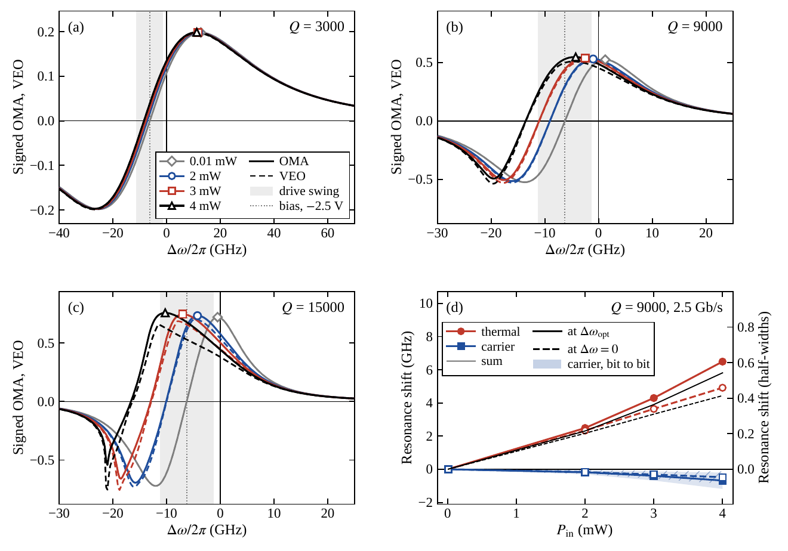
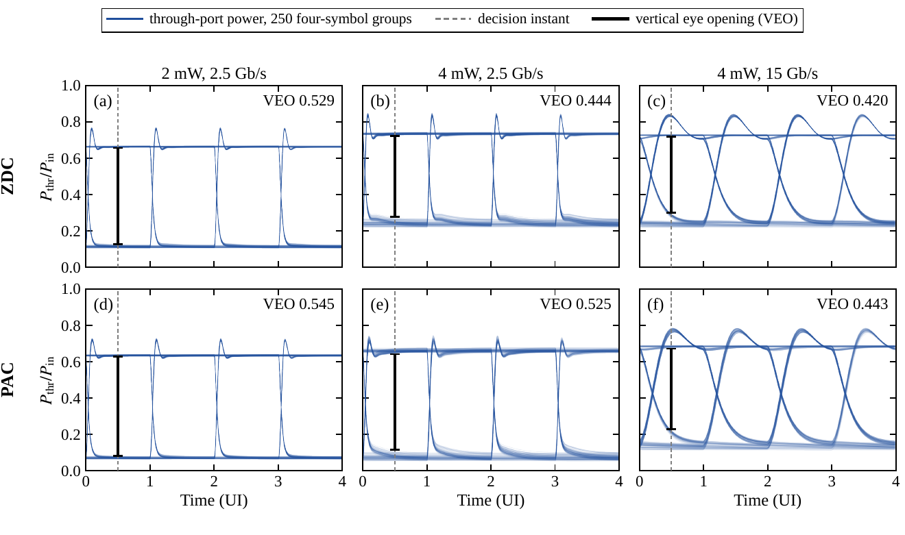
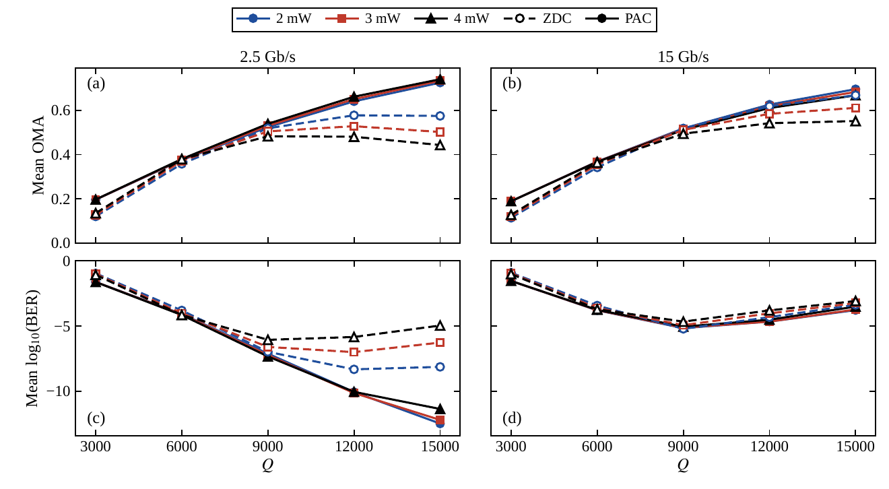
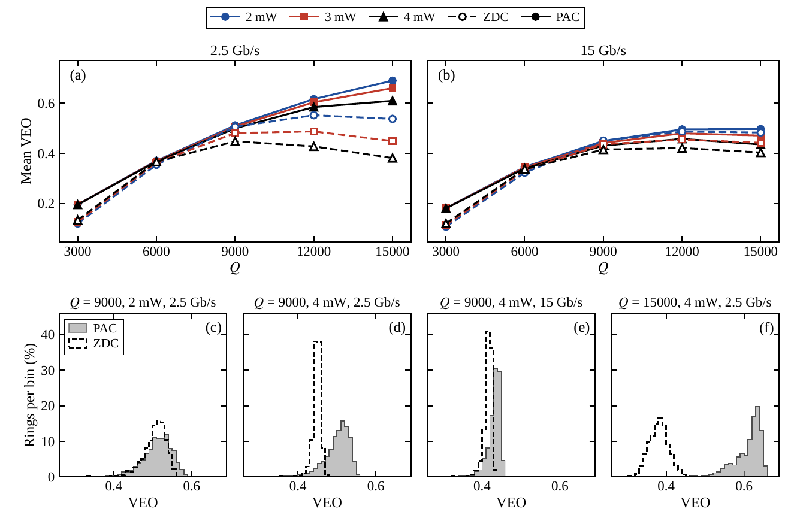
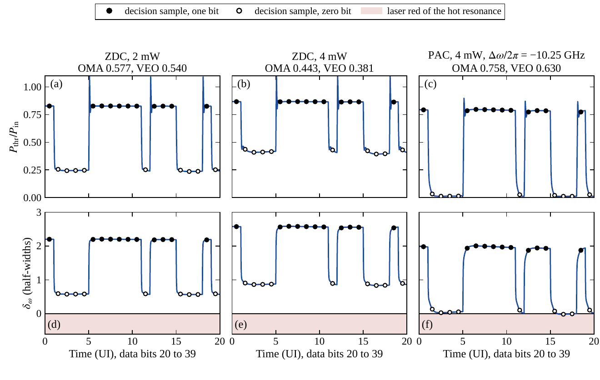
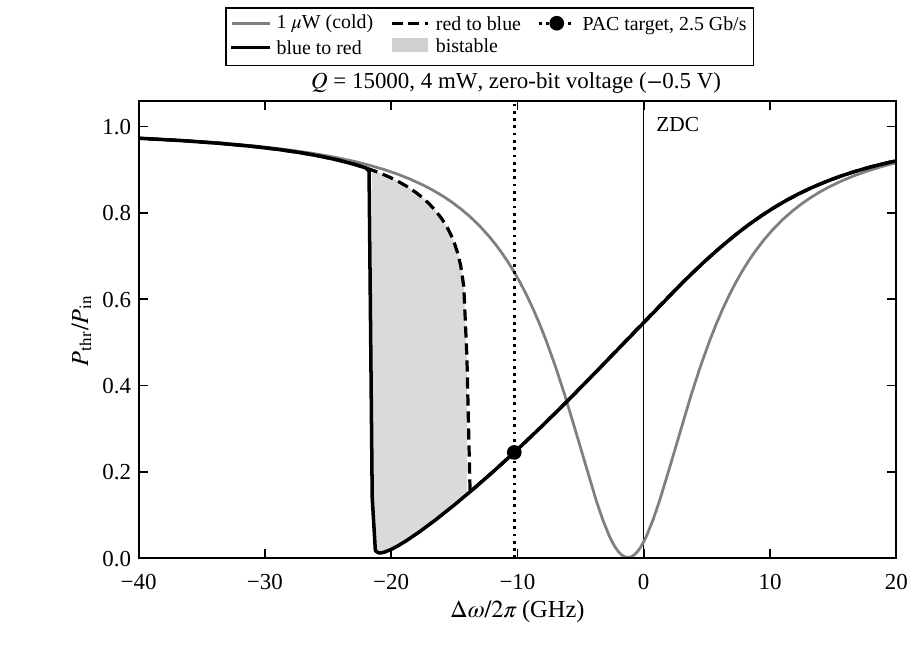
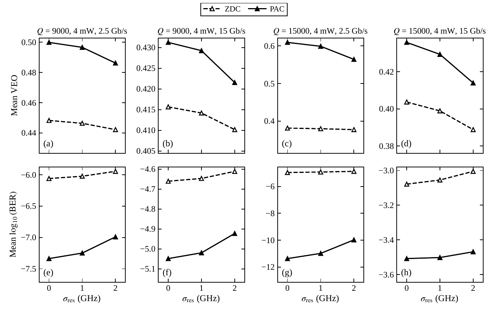

# mrr-modulator-sim

Simulation of a voltage-driven silicon microring modulator with self-heating, free carriers and two-photon absorption, and of how fabrication variation affects it. This is the code behind the microring results of my MS thesis (University of Kentucky, 2026).

The model is the 5-state coupled-mode system of Giron Castro (2024) with the voltage modulation of de Cea (2019). The states are the cavity field (real and imaginary parts), the free-carrier density, the temperature rise and the junction voltage. It is integrated with RK4 in normalized time (tau = gamma_0 * t) at a 1 ps step.

The main question is where to put the laser. Two choices are compared on a population of 2000 fabricated rings:

- **ZDC** puts the laser at zero detuning from each ring's cold resonance.
- **PAC** puts it at the power-aware detuning `dw_opt`. This is the detuning of largest OMA on the nominal ring at the same Q, input power and bit rate.

The as-fabricated case (**AF**, laser at the cold design resonance) is run on rings 1 to 500.

## Results

The population covers 2000 rings at loaded quality factors from 3000 to 15000, input powers of 2 to 4 mW, and bit rates of 2.5 and 15 Gb/s. The best detuning moves to the red with power, more so at high quality factor. Correcting each ring to this power-aware detuning beats zero-detuning correction in 29 of 30 configurations, by up to 6.4 decades of bit error rate.

The figures below are from the thesis and are made by `python/figures.py`.

### Where the best detuning sits



Signed OMA (solid) and VEO (dashed) of the nominal ring versus laser detuning at 2.5 Gb/s for Q = 3000 (a), 9000 (b), and 15000 (c), with the drive swing shaded, and the mean thermal and carrier resonance shifts at Q = 9000 versus input power (d), at Δω_opt (solid) and at zero detuning (dashed). The best detuning moves to the red with power, by up to 6.00 GHz at Q = 15000 between 2 and 4 mW, following a thermal shift that is nearly ten times the carrier shift.

### Eye diagrams



Through-port eye diagrams of a typical fabricated ring (loaded Q of 9851) for ZDC (a)–(c) and PAC (d)–(f) at 2 mW and 2.5 Gb/s, 4 mW and 2.5 Gb/s, and 4 mW and 15 Gb/s, with PAC at the step 1 targets. Every eye is open, and PAC keeps the wider eye, most at 4 mW and 2.5 Gb/s (VEO 0.525 against 0.444).

### 2000 fabricated rings



Mean OMA (a), (b) and mean log10(BER) (c), (d) over 2000 rings versus Q at 2.5 and 15 Gb/s, for ZDC (dashed, open markers) and PAC (solid, filled markers), with color and marker shape marking the input power. PAC gains most at high Q and power, up to 6.41 decades of mean BER at Q = 15000, 4 mW, and 2.5 Gb/s.



Mean VEO over 2000 rings versus Q at 2.5 Gb/s (a) and 15 Gb/s (b), coded as in the figure above, and the VEO of every ring for four cases (c)–(f), with PAC as gray bars and ZDC as dashed outlines. Power separates the two populations, (c) to (d) and (f), while the higher bit rate pulls them back together (e).

### Why zero detuning falls behind



Through-port power (a)–(c) and laser position from the hot, biased resonance δω in half-widths (d)–(f) for the nominal ring at Q = 15000 and 2.5 Gb/s, for ZDC at 2 mW, ZDC at 4 mW, and PAC at 4 mW and −10.25 GHz, over data bits 20 to 39. Heating pushes the ZDC zero level up as the zero bits move away from the resonance, and PAC holds them 0.09 half-widths from it.



Continuous-wave through-port power of the nominal ring at the zero-bit voltage (−0.5 V), Q = 15000, and 4 mW, swept from blue to red (solid) and from red to blue (dashed), with the cold response at 1 µW, the bistable band shaded, and the 2.5 Gb/s PAC target marked. The target sits 3.75 GHz to the blue of the band, where both sweep directions give the same power.

### Residual tuning error



Mean VEO (a)–(d) and mean log10(BER) (e)–(h) over 2000 rings versus the standard deviation σ_res of the tuning error at 4 mW, for ZDC (dashed, open markers) and PAC (solid, filled markers). PAC stays ahead of ZDC at every error tested.

## Requirements

- MATLAB with the Parallel Computing Toolbox. Without the toolbox, `parfor` runs as a plain loop with the same results, just slower. The code also runs in GNU Octave, where it uses the saved ring draw.
- Python 3 with numpy, scipy and matplotlib, for the figures and tables.

## Layout

```
README.md
docs/figures/           figure images used in this README
matlab/
  mrr_params.m          model parameters and run settings (one place for every value)
  ring_params.m         normalized coefficients of one ring
  ring_population.m     the 2000-ring draw (rng(42)), checked against ring_population_seed42.mat
  make_drive.m          PRBS-10 NRZ drive and warm-up
  run_case.m            one run of one ring and its metrics (eye, trace, time-step check)
  sim_mrr_eye.m         solver, through-port power over the data window
  sim_mrr_fulltrace.m   same solver, also records the internal states
  sim_mrr_cw_sweep.m    quasi-static cw detuning sweep (bistability)
  mod_rk4_step.m        one RK4 step and the right-hand side of the model
  utils.m               small helpers (output folders, summary files, parallel pool)
  step0_checks.m ... step7_tuning_error.m
  run_all.m             runs every step in order
python/
  mrr_data.py           loaders for the MATLAB outputs
  figures.py            thesis figures
  tables.py             thesis tables
```

## Parameters

Every value is in `mrr_params.m`. A few that matter most:

| Parameter | Value |
|---|---|
| Ring mass | 1.2e-14 kg (from the geometry: radius 7.5 um, 500 nm x 220 nm strip) |
| TPA coefficient | 8.4e-12 m/W |
| Thermal time constant | 50 ns |
| Carrier lifetime | 0.1 ns |
| Drive | -2.5 V bias, 4 V peak to peak (zero bit -0.5 V, one bit -4.5 V) |
| Q | 3000, 6000, 9000, 12000, 15000 |
| Input power | 2, 3, 4 mW |
| Bit rate | 2.5 and 15 Gb/s |
| Data window | 1000 symbols of PRBS-10 |
| Warm-up | 250 ns ramp from the blue side, then 250 ns held at the target |
| Fabrication spread | resonance offset 0.65 nm, loss and coupling time 10 % |
| Receiver noise floor | 5 % of the input power |

## How to run

Start MATLAB in `matlab/` and run `run_all`, or run the steps one at a time in this order. Each step writes to `out/<step name>/`. Times are for 4 workers.

| Step | What it does | Time |
|---|---|---|
| `step0_checks` | parameter values, heat-source and steady-state check, heating at 4 mW, warm-up check | a few min |
| `step1_sweeps` | detuning sweeps of the nominal ring, `dw_opt` and `dw_lin` for every Q, power and bit rate | about 2 h |
| `step2_mechanism` | thermal and carrier resonance shifts at zero detuning and at `dw_opt` | a few min |
| `step3_eyes` | eye waveforms of a typical fabricated ring, ZDC and PAC | 1 min |
| `step4_ring_dynamics` | full traces, self-pulsation test, cw bistability | about 20 min |
| `step5_convergence` | time step, warm-up and data-window checks, 1 uW linear limit | about 15 min |
| `step6_population` | 2000 rings, 30 configurations, ZDC, PAC and AF | about 10 h |
| `step7_tuning_error` | residual tuning error added to both targets | about 3 h |

- Every step after `step1_sweeps` reads its targets from step 1. `step7_tuning_error` also needs step 6.
- Steps 1, 6 and 7 save a checkpoint as they go, so a stopped run picks up where it left off.
- Each step writes a `summary.txt` with its numbers and checks, and `.mat` files with the full results.

**Quick test.** Run `setenv('MRR_SMOKE','1')` first. Every step then finishes in minutes on a coarse grid with 12 rings, and writes to `out_smoke/`. Never use those numbers. Run `setenv('MRR_SMOKE','0')` to go back.

**Speed.** `sim_mrr_eye.m` can be compiled with MATLAB Coder. The command is in its header. Then call `sim_mrr_eye_mex` in `run_case.m`. The results are identical.

## Figures and tables

From `python/`:

```
python3 figures.py ../matlab/out
python3 tables.py ../matlab/out
```

Figures go to `out/figs/` as `.pdf` and `.png`, and tables go to `out/tables/` as LaTeX. Each one is made only when its inputs exist.

| Figure | Content |
|---|---|
| `A1_mechanism` | OMA and VEO of the nominal ring versus detuning, and the thermal and carrier shifts versus power |
| `A2_population_metrics` | mean OMA, mean BER and invalid rings versus Q |
| `A3_veo` | mean VEO versus Q and VEO histograms |
| `A4_eye` | eye diagrams, ZDC and PAC |
| `B2_traces` | through-port power and laser position from the hot resonance |
| `bistability` | cw transmission in both sweep directions at 4 mW |
| `B4_robustness` | mean VEO and BER versus the tuning error |

| Table | Content |
|---|---|
| `table_dwopt` | power-aware detuning and low-power optimum |
| `table_linear_limit` | 1 uW linear-limit check |
| `table_convergence` | time step, warm-up and data window |
| `table_bistable` | bistable bands at 4 mW |
| `table_population` | means and invalid rings for every configuration |
| `table_receiver_floor` | ZDC and PAC at three receiver floors |
| `table_tuning_power` | tuning power per ring |

## Notes

- Detuning is the laser frequency minus the cold, unbiased resonance. A positive value puts the laser on the blue side.
- OMA and VEO are normalized to the input power and signed. A negative OMA means the levels are inverted. A ring is invalid when its VEO is below zero.
- The metrics are taken at the center sample of every symbol. The BER is 0.5 erfc(Q_f/sqrt 2), with the receiver noise floor added in quadrature to the spread of each level.
- The solver splits a step into substeps when |detuning| x step would exceed 2.4. A single 1 ps step is unstable there, which happens at the start of the ramp at Q = 3000 and for far-detuned as-fabricated rings. Everywhere else it takes one step.
